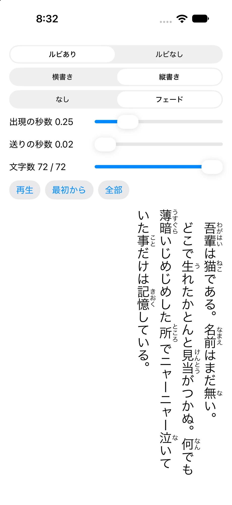

stone_engineは、日本語の文字組版を実現する、iOS / macOS向けのテキストレンダリングエンジンである。

## 対応環境

- iOS 17以降
- macOS 14以降
- Swift 5.9以降

## 導入

Swift Package Managerで導入する。`Package.swift`に次を追加する。

```swift
dependencies: [
    .package(url: "https://github.com/ndc-stone/stone_engine.git", from: "0.6.0"),
],
targets: [
    .target(name: "YourApp", dependencies: ["stone_engine"]),
]
```

Xcodeでは、File > Add Package Dependencies...から同じURLを指定する。

## 使い方

```swift
import stone_engine

let textView = STTextView(frame: view.bounds)
textView.direction = .tbRl  // 縦書き
textView.fontSize = 17
textView.lineHeightScale = 1.625
textView.text = "吾輩は猫である。名前はまだ無い。"
view.addSubview(textView)
```

縦書きで表示範囲の両端の行を欠けずに表示するには、`STTextView`の幅を行送り（`fontSize * lineHeightScale`）の整数倍にする。

動かして確かめられるサンプルがある。[サンプル](#サンプル)を参照。

### SwiftUI

SwiftUIでは、`StoneEngineSwiftUI`を使う。ターゲットの依存関係に追加する。

```swift
.target(
    name: "YourApp",
    dependencies: [
        .product(name: "StoneEngineSwiftUI", package: "stone_engine"),
    ]
)
```

```swift
import SwiftUI
import StoneEngineSwiftUI
import stone_engine

struct ContentView: View {
    @State private var text = "吾輩は猫である。名前はまだ無い。"

    var body: some View {
        VStack {
            STLabelView(text, direction: .lrTb, fontSize: 17)
            STTextEditor(text: $text, direction: .tbRl, fontSize: 17, lineHeightScale: 1.625)
        }
    }
}
```

`STTextEditor`は、両端の行が欠けないよう、行を重ねる方向の大きさを行送りの整数倍にする。日本語の変換中は、バインディング側の変更で本文を上書きしない。

## サンプル

`sample/SwiftUI/StoneEngineSwiftUISample.xcodeproj`に、iOS / macOS共通のサンプルアプリがある。ターゲットは二つで、見たいものによって使い分ける。

パッケージはローカル参照で繋いである。リポジトリを clone して開けば、そのまま手元のソースでビルドされる。

### StoneEngineSwiftUISample

組版そのものを見るためのもの。組み方向、文字サイズ、行送りをその場で変えながら、`STLabelView`と`STTextEditor`の組まれ方を確かめられる。

### StoneEngineRevealSample

[文字を一つずつ出す](#文字を一つずつ出す)振る舞いを見るためのもの。

|  |
|:--:|
| 縦書き、ルビあり、フェードで出しているところ |

ルビのあり／なし、組み方向、出現のしかたを切り替えられる。送りは「再生」で自動で進むが、スライダで一文字ずつ動かすこともできる。**出現の途中で止めて、その一文字を見るためである。**

「文字数 72 / 72」の分母は`STContext.revealCharacterCount(of:rubyNotation:)`が返す数である。ルビありの本文に切り替えても、読みの分は増えない。


## 目的

stone_engineは、iOSおよびmacOS上で動作するテキストレンダリングエンジンである。
その第一義の目的は、日本語の高度な組版を実現することである。具体的には、縦書き、禁則処理、約物処理、文字種ごとのスケーリングが挙げられる。
また従来の紙媒体によるページ分割を前提とした組版とは違い、電子媒体による大きさに制約のない画面上での組版を模索するものである。

副次的な目的として、プログラマにとって直接内部構造を触ることのできるレンダリングエンジンがほしい、という欲求がある。
あらゆるOSやプラットフォームにとって、テキストのレンダリングとは極めて基本的な機能の一つであり、十分な機能のものがすでに与えられている。
iOSであれば、UIKitのUILabelやUITextView、Swift UIのTextなどがそれにあたる。
それらは使い勝手は問題ないものであるが、その一方で高度にブラックボックス化されており、内部情報に十分にアクセスすることはできない。
たとえば、UILabelで、文字ごとにそれがframeのどこにレイアウトされているか、という情報を得ることはできない。
プログラマであるならば、それらの情報にアクセスできることで、どれだけの可能性が広がるか想像できるだろう。

そのような、ある種トイボックスとして使えるようなレンダリングエンジンを提供することが、隠された目的である。

## 方針

上述の目的のために、以下の方針を定める。

### アプリのための日本語文字組版

電子媒体、中でもアプリに特化した日本語文字組版のあるべき姿を模索する。
紙媒体と比較して、アプリで使われる画面には、以下の特徴がある。

- 画面サイズが不定
- 実行中にサイズが変更される
- スクロールにより極端に広くなる
- ページングの不在

これらの条件下で、あるべき組版のありかたとその実装を実現する。

### 実行速度を最優先

テキストレンダリングエンジンは、low levelの機能である。
あらゆるアプリの基底として使われるものであり、そこには高い実行速度が求められる。
stone_engineは、実行速度を最優先として、そのアーキテクチャ、データ構成、使用言語などを決めていく。

## 提供クラス

stone_engineは、`STLabel`と`STTextView`というクラスを提供する。これは、UIKitやAppKitにおけるラベルとテキストビューを置き換えることを意図している。

## STLabel

STLabelは、画面にテキストを表示するためのビュークラスである。編集はできない。次のような特徴を有する。

### 文字描画方向の指定

文字を描画する方向として、`LrTb`または`TbRl`を指定できる。TbRlは、いわゆる縦書き表示である。

|  |
|:--:|
| `LrTb`（横書き表示） |

|  |
|:--:|
| `TbRl`（縦書き表示） |

### 縦書き表示

縦書き表示では、フォントを描画するときに適切なグリフが選択される。たとえば、句読点、括弧などに適用される。

数字を表示するときは、いわゆる縦中横が反映される。数字が2桁以下のときは、正体で表示される。2桁より大きいとは、90度回転して表示される。

アルファベットは、90度回転して表示される。

|  |
|:--:|
| 数字の縦中横表示と、アルファベットの90度回転表示 |


### 禁則処理

禁則処理は、行頭禁則および行禁則が行われる。禁則の対象となる文字種を指定可能である。

禁則処理の、オン／オフを指定することが可能である。

### 約物半角

約物（句読点や括弧類）を、半角で表示させることができる。約物の取り扱い方を、以下のモードで指定することができる。

- 常に全角
- 常に半角
- 前後の文字種や行中の位置で、適切に判断する（stoneモード）

|  |
|:--:|
| 常に全角 |

|  |
|:--:|
| 常に半角 |

|  |
|:--:|
| stoneモード |

### フォントの指定

STLabelでは、文字種ごとにフォントを指定することが可能である。

|  |
|:--:|
| 日本語フォント：游明朝<br>ラテン文字フォント：Times New Roman |

|  |
|:--:|
| 日本語フォント：游ゴシック<br>ラテン文字フォント：Helvetica |

指定可能な文字種は、Unicodeカテゴリとして定義される。

### 文字種ごとのスケーリング

STLabelでは、文字種ごとに表示するスケールを指定することが可能である。たとえば、日本語フォントとして1.0、ラテン文字フォントとして0.9を指定すると、次のような描画になる。

|  |
|:--:|
| 日本語フォントスケール：1.0<br>ラテン文字フォントスケール：0.9 |

### 文字寄せ

文字寄せとして、以下が指定可能である。

- 行頭
- 中央
- 行末
- 均等

### 文字の縁取り

文字のまわりを縁取ることができる。写真や絵の上に文字を置くとき、背景の明暗にかかわらず文字が読めるようにするためのものである。

```swift
stLabel.borderColor = .white
stLabel.borderWidth = 2
```

`borderWidth`は縁が文字の外側へ張り出す幅である。縁はグリフの輪郭の外側だけに描かれ、文字そのものの太さは変わらない。縁は本文を塗るより先に、すべての文字について描かれる。隣の文字の上に縁が乗らないようにするためである。

絵文字のように色付きのビットマップで描かれるグリフには輪郭がないため、縁取りは行われない。

`borderWidth`が0のとき、または`borderColor`が透明なときは、何も描かれない。既定ではどちらもそうなっている。

### 行の高さと、切れる足もと

**行は、言われた高さにしか組まれない。** `lineHeightScale`が1.0なら、行の高さは文字の大きさそのものである。

ところが**多くの書体は、em（文字の正方形）より背が高い。** 上に伸びる分と下に伸びる分を足すと1.2em前後あり、書体によってはもっと大きい。行がemしか無ければ、**はみ出した足もとは描かれずに切れる。**

切れても何も言わない。組版も寸法もあくまで言われた行の高さで行われ、はみ出すのは描画だけだからである。

必要な最小値は`minimumLineHeightScale`で求める。

```swift
let label = STLabel(frame: view.bounds)
label.setFontNames(["ChalkboardSE-Bold"], script: .latin)
label.lineHeightScale = label.minimumLineHeightScale
```

返るのは、字母の先頭に置いた書体の`(アセント + ディセント) / em`である。Chalkboard SEなら1.41。1.0のまま組むと、文字の4割が切り落とされる。

文字種ごとの倍率（`setFontScale(_:script:)`）は既に織り込まれている。小さく組む書体は、そのぶん少ない行の高さしか要求しない。

**ルビの分は別である。** 読みは行が文字の上に残した余白に組まれるので、ルビを使うならこの値にさらに足す。

### 単語分割

日本語単語分割のオン／オフを指定することができる。これは、改行を行うときに単語を分割するか、しないかを決定するものである。

### 行数制限と省略記号

テキストを組む行数を`maxLineCount`で制限できる。0なら制限しない（既定）。

```swift
label.maxLineCount = 2
label.isShownEllipsis = true
```

制限を超えた行は**組まれたうえで描かれない**。どこで行が変わるかを知らなければ行数も数えられないため、組むところまでは行う。描かれない行は、テキストが返す大きさにも入らない。

`isShownEllipsis`を指定すると、最後に描かれる字が省略記号に替わる。記号は置き換える字より広いことが多いので、入らなければ手前の字を譲っていく。譲れる字が無い行は、記号を出さずにそのままにする。

行数で切り詰められたテキストは`isTruncated`が真になる。`adjustsFontSizeToFitWidth`はこれを見るので、**指定した行数に収まるまで文字を小さくしてから**、それでも入らないぶんだけが落ちる。

ルビのある語に記号がかかるときは、記号を読みの上には置かない。読みは本文より小さく行の上に組まれるので、そこに記号があると下の語の読みに見えるためである。記号が語を切ったときは、残った語の上に読みを寄せ直す。

### ルビ

本文に書き込まれた読みを、横組みでは語の上に、縦組みでは語の右に組むことができる。

既定ではルビを読まない。`rubyNotation`で記法を指定したときだけ、本文から読みを取り出して組む。指定しなければ、記法に使う記号もただの文字として組まれる。

```swift
let label = STLabel(frame: view.bounds)
label.rubyNotation = .braces
label.lineHeightScale = 1.5
label.text = "今日は{晴天|せいてん}なり"
```

SwiftUIでは`STLabelView`の引数で指定する。

```swift
STLabelView("今日は{晴天|せいてん}なり", rubyNotation: .braces)
```

**読みは行の上の余白に組まれる。** `lineHeightScale`が1.0のままだと、読みが上の行に食い込むか、上端で切れる。本文の半分の大きさの読みであれば1.5で収まる。`STLabelView`の既定は1.5なので、そのままでよい。

#### 記法

| 指定 | 書き方 |
|:--|:--|
| `.none`（既定） | ルビを読まない |
| `.aozora` | `漢字《かんじ》` / `｜漢字《かんじ》` |
| `.braces` | `{漢字\|かんじ}` |

`.aozora`は青空文庫の記法である。全角の記号を使うので、ASCIIばかりの本文と取り違えにくい。

語を言わない`漢字《かんじ》`の形では、`《`の直前の文字と**同じ種別**（漢字・ひらがな・カタカナ・英数）を遡った範囲が読まれる語になる。種別が混ざる語は、`｜`で語の先頭を言う。

```
今日は漢字《かんじ》です      → 「漢字」に「かんじ」
｜お手上げ《おてあげ》        → 「お手上げ」に「おてあげ」
そこでかんじ《・・・》        → 「そこでかんじ」全体が語になる（｜ を使う）
```

`.braces`は全角の記号を打たずに書ける代わりに、`{`も`|`も普通の文に出る文字を使う。`\{`と書いた括弧は組を始めない。

#### 組として成り立たない書き方

**組になっていない文字列は、1文字も変えずに組む。** 閉じ忘れた括弧が以降を飲み込むようなことはしない。

```
設定{を開く            → そのまま「設定{を開く」
温度は{25}度           → そのまま（区切りがない）
x = {1, 2} | y         → そのまま
漢字《かんじ            → そのまま（閉じていない）
```

読みが空の組（`{漢字|}`）は、語だけが組まれてルビにならない。書きかけの印であって、乗せるものがないためである。

#### 読みの大きさ

`rubyFontScale`で決める。既定は本文の半分（0.5）。

語と読みは、広いほうが幅（縦組みでは高さ）を決め、狭いほうがその中で中央に寄る。行末に収まらない組は、語と読みを割らずに次の行へ送る。

#### 自前の記法

`STContext.rubies`に`STRuby`を直接積めば、どんな記法でも組める。`STRuby`は読まれる語のランの範囲と、読みのランの範囲を持つ。


### 文字を一つずつ出す

本文を先頭から一文字ずつ出すことができる。会話や字幕のように、読み手の速さに合わせて文字を送る表示のためのものである。

```swift
label.revealAnimation = .fade
label.revealedCharacterCount = 0
label.text = "吾輩は猫である。"
```

あとは`revealedCharacterCount`を増やしていくと、そこまでの文字が出る。**送る速さを決めるのは呼び出し側である。** エンジンが受け持つのは、いま届いた一文字をどう出すかだけである。

**組み直しは起きない。** 本文は最初から最後まで組んであり、`revealedCharacterCount`が動いても変わるのは描くところだけである。文字列を途中で切って渡す方法と違い、**文字が増えても改行位置が動かない。** 足すたびに組み直せば、行末の語が次の行へ飛んだり、行が増えて下の要素が動いたりする。

#### 出現のしかた

| 指定 | |
|:--|:--|
| `.none`（既定） | そのまま出る |
| `.fade` | 無色から文字色まで立ち上がる |
| `.pop` | 小さく出て、原寸を少し行き過ぎてから収まる |
| `.rise` | 潰れた字が、置かれる場所の足もとから立ち上がる |
| `.drop` | 上から落ちてくる。落下なので加速する |
| `.spin` | 中心で半回転しながら、小さく出て原寸に戻る |
| `.flip` | 真横を向いた状態から、正面へ開く |
| `.flyIn` | 一方から滑り込んで止まる |

`revealDuration`は、一文字が出きるまでの秒数である。既定は0.2秒。`.none`のときは使われない。

縁取りも文字と一緒に出る。

`.flyIn`だけは、どこから来るかを`revealOrigin`で決める。既定は`.bottom`。

| | |
|:--|:--|
| `.top` / `.bottom` / `.left` / `.right` | 辺から |
| `.topLeft` / `.topRight` / `.bottomLeft` / `.bottomRight` | 角から |

**画面の上下左右であって、行の進む向きではない。** 読み始める側から出すと、そこは次の文字が現れる側でもあるので、ほとんど動かない効果になる。画面基準なら、縦組みでも横組みでも同じ設定が同じ見え方をする。

同じ理由で、`.rise`は常に下から立ち上がり、`.drop`は常に上から落ちる。

#### 何文字あるか

`revealedCharacterCount`の既定は`Int.max`で、全部出ている状態である。何も指定しなければ、これまでどおり本文がそのまま出る。

上限は`STContext.revealCharacterCount(of:rubyNotation:)`で求める。

```swift
let count = STContext.revealCharacterCount(
    of: "今日は{晴天|せいてん}なり", rubyNotation: .braces
)   // 7
```

**読みは文字に数えない。** 記法の記号も数えない。`{晴天|せいてん}`は2文字である。読む側の文字数と一致させるためで、組む前に答えが要るので、ラベルではなくここで求める。

#### ルビ

**読みは語と同時に出る。** 語の先頭の文字が出るとき、その語の読みも一緒に出る。語が出終わるのを待つと、読みが語より後から来てしまうためである。

**そして読みは、語といっしょに動く。** 位置も大きさも、読み自身の枠ではなく語の枠を基準に変えている。読み自身の（小さい）枠を中心に拡大すると、読みが語から離れて飛ぶためである。

これは`.fade`では起きない。字を動かす効果を入れた時点で出てくる問題である。自前の効果を足すときも、`drawing(progress:anchor:origin:)`が受け取る`anchor`は既に語の枠になっている。

#### SwiftUI

`STLabelView`の引数で指定する。

```swift
STLabelView(
    "今日は{晴天|せいてん}なり",
    rubyNotation: .braces,
    revealAnimation: .flyIn,
    revealedCharacterCount: count,
    revealDuration: 0.25,
    revealOrigin: .bottomLeft
)
```

`sample/SwiftUI`の`StoneEngineRevealSample`ターゲットで、実際の動きを見ることができる。


## STTextView

STTextViewは、テキストの編集を行うためのビュークラスである。STLabelが持つ特徴をすべて有する。

## 開発

テストの実行方法や、変更を提案する手順は[CONTRIBUTING.md](CONTRIBUTING.md)を参照。変更履歴は[CHANGELOG.md](CHANGELOG.md)にある。

## ライセンス

[MIT License](LICENSE)
